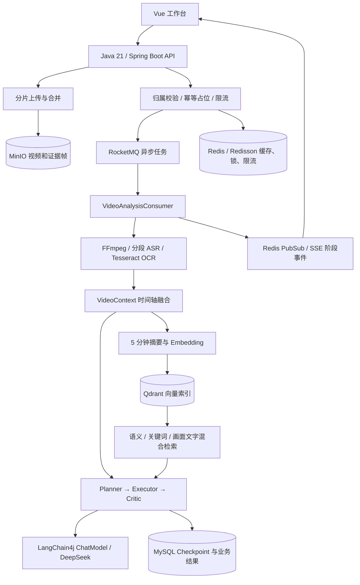
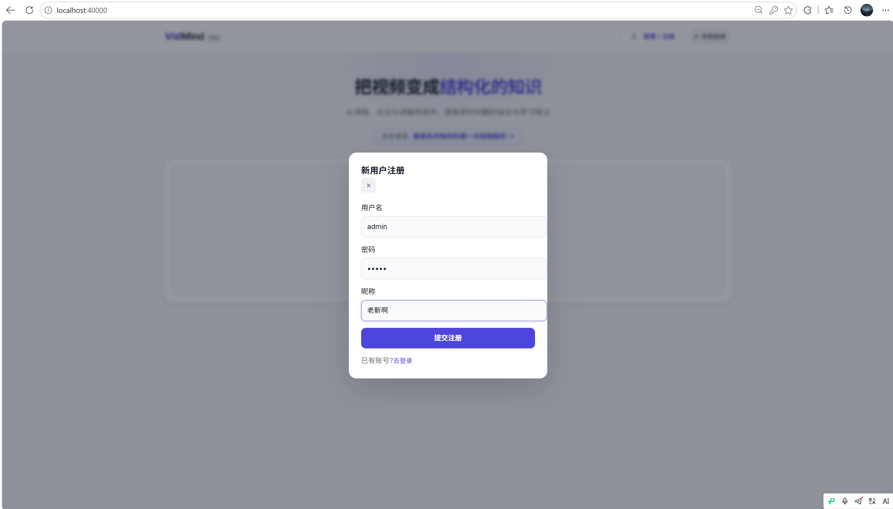
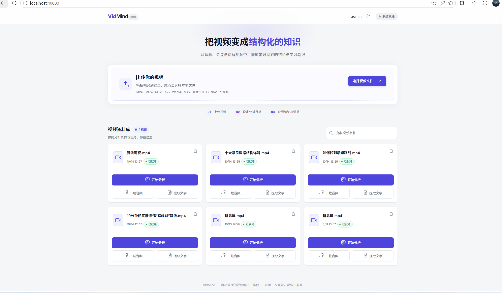
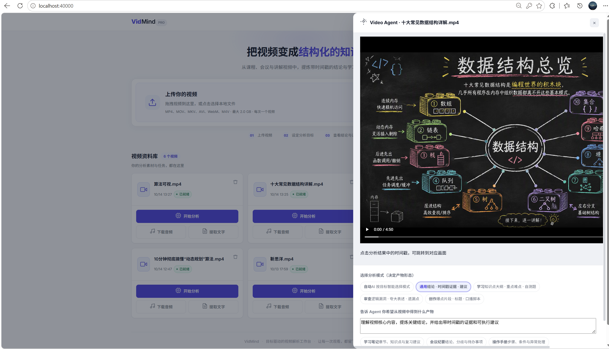
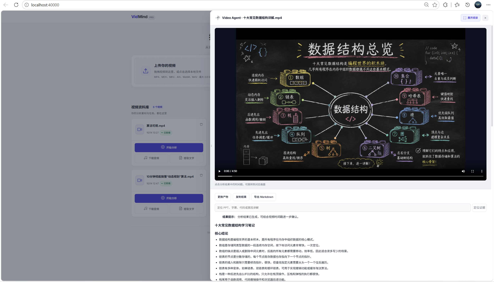

# VidMind

VidMind 是以 **Java 后端与 LangChain4j 模型接入**为核心的长视频 Agent 项目。它将视频中的语音和画面文字整理为带时间轴的上下文，通过分段摘要、混合检索与 Planner → Executor → Critic 循环生成结构化分析结果。Vue 工作台用于上传、选择分析模式、查看进度和证据，是后端能力的演示入口。

适合学习异步任务、对象存储、多模态预处理、RAG 检索、Agent 状态恢复与成本约束。当前是可继续完善的工程项目，生产部署前应阅读 [风险与验证清单](docs/engineering-risks.md)。

## 后端主链路与系统架构



API 接收任务后返回，消费者承担视频解析与模型调用。MySQL 保存可恢复产物，Redis 保存热缓存和临时协调状态，MinIO 保存大文件，Qdrant 负责带媒体过滤的语义召回。Docker Compose 启动中间件；后端与前端在宿主机运行。

LangChain4j 的实际使用位置是 `DeepSeekUtils` 中的 `OpenAiChatModel`、`ChatModel` 和消息对象。Agent 循环、检索加权、Checkpoint、失败台账由 Java 服务自行实现；并未使用 LangChain4j 的完整 RAG 检索器或自动工具调用 Agent 框架。

## 核心模块职责

| 模块 | 源码入口 | 职责 |
| --- | --- | --- |
| 认证与媒体权限 | `AuthService`、`AuthInterceptor`、`MediaService` | PBKDF2 密码、Redis 会话、用户归属检查 |
| 大文件上传 | `ChunkUploadService` | 每片最多 5 MiB、记录分片、合并锁、流式计算内容指纹 |
| 提交与异步消费 | `AnalysisDispatchService`、`VideoAnalysisConsumer` | 配额、内容/目标/模式键、RocketMQ 消费、重试与失败处理 |
| 视频解析 | `VideoContextService`、`SegmentedTranscriptionService` | 分段语音、关键帧 OCR、60 秒时间窗口融合、单分支降级 |
| 长视频 RAG | `VideoChunkingService`、`VideoEvidenceRetrievalService`、`LongVideoContextService` | 5 分钟知识块、Embedding、TopK 混合召回、上下文裁剪 |
| 模型接入 | `DeepSeekUtils`、`EmbeddingUtils`、`AliyunAsrUtils` | ChatModel、向量与 ASR API；ASR 实际默认是 SiliconFlow，类名是历史命名 |
| 受控 Agent | `AgentLoopService`、`EvidenceVerificationService` | 规划、执行、批评、结构与引用校验、预算终止 |
| 持久化恢复 | `AgentCheckpointService`、`AgentCheckpointRepository` | MySQL 持久化与提交后 Redis 缓存同步 |
| 观测和失败处理 | `AgentTelemetry`、`TaskEventService`、`FailedAnalysisTaskService` | 估算 token/成本、阶段 SSE、失败台账与人工重放 |

## 项目难点与当前解决方案

长视频文本分块采用 5 分钟核心窗口，左右各纳入 60 秒重叠文本（首块向零截断）。边界处的解释与后续结论可进入相邻块的摘要/Embedding，减少上下文割裂；检索按原始时间范围去重，避免重复证据挤占上下文。重叠会增加索引与摘要调用输入，召回改善仍需标注集验证。既有 Checkpoint 分块不会自动重建，需要用新视频或显式重建索引验收。

异步消费默认最多 3 次执行尝试。暂态失败交由 RocketMQ 重投，永久失败或次数耗尽进入失败台账/失败主题；失败主题投递自身失败时不再重新跑模型。锁竞争请求重投而非直接确认，已有持久结果也可在 Redis 完成标记过期后拦截重复执行。Broker 用尽重投次数后进入自身 DLQ，需运维检查 Broker DLQ 与应用失败主题两处；这仍不是跨系统恰好一次保证。

1. **长任务不能占住 HTTP 请求。** 分析进入 RocketMQ，SSE 展示阶段。锁和幂等键减少重复工作，但不能宣称跨 Redis、MQ、MySQL 的 exactly-once。
2. **数小时视频不能全部塞进 prompt。** 以 5 分钟知识块摘要和向量召回筛选原始片段，关键词与 OCR 补充召回；默认 TopK 为 3，再施加上下文字符预算。没有相似度阈值，召回质量需要数据集验证。
3. **模型产物不可靠。** 固定结果结构，Critic 反馈驱动补检索，默认最多两轮；引用校验确认原文与时间范围，不能代替语义蕴含或事实核查。两轮后仍可能输出带警告结果。
4. **解析与外部服务容易失败。** ASR/OCR 使用独立有界线程池；模型有限重试；阶段产物落库，部分路径可从草稿或 Critic 检查点恢复。预算只覆盖 Agent 阶段，并不限制整个下载/解析任务。
5. **模型成本需要可见。** 记录阶段耗时与估算 token/费用，时长、轮数、估算 token 有预算。费用默认关闭；配置价格后仍是估算值，不能作为供应商账单。

更多源码级追问见 [面试问答](docs/interview-qa.md)，运行边界见 [工程风险](docs/engineering-risks.md)。

## 技术栈

| 层次 | 技术 | 用途 |
| :--- | :--- | :--- |
| Web | Vue 3、Vite、SSE、Marked | 上传、Agent 工作台、实时进度与安全 Markdown 展示 |
| API | Java 21、Spring Boot 3.5.9、Undertow、MyBatis-Plus | 鉴权、媒体管理、任务编排与 REST API |
| 异步与缓存 | RocketMQ 5.3.4、Redis 7.4、Redisson | 异步削峰、状态缓存、限流、锁与消费幂等 |
| 数据与存储 | MySQL 8、MinIO、Qdrant | 业务数据、视频对象、Checkpoint 与向量检索 |
| 视频与 AI | FFmpeg、Tesseract、LangChain4j、DeepSeek、TeleSpeechASR、BGE-M3 | 音视频处理、多模态解析、Agent 推理与 Embedding |
| 部署 | Docker Compose | 本地中间件编排 |

## 本地运行

### 环境要求

| 组件 | 要求 | 说明 |
| :--- | :--- | :--- |
| JDK | 21 | 后端运行环境 |
| Node.js | 22 | Vue 与 Vite 构建环境 |
| Docker | Compose v2 | 启动 MySQL、Redis、MinIO、Qdrant 与 RocketMQ |
| FFmpeg | 可在终端调用 | 音频切分与关键帧抽取 |
| Tesseract | 安装 `chi_sim` 与 `eng` | 中英文关键帧 OCR |
| yt-dlp | 可选 | 仅解析在线视频链接时需要 |

建议先确认命令均可用：

```bash
java -version
node --version
docker compose version
ffmpeg -version
tesseract --version
```

### 1. 准备配置

```bash
cp .env.example .env
```

编辑 `.env`，至少替换数据库、Redis、MinIO、Qdrant 的示例密码并设置 `SILICONFLOW_API_KEY`。全新数据库中 `DB_USERNAME` 与 `MYSQL_APP_USER` 应保持一致；`MYSQL_ROOT_PASSWORD` 仅供数据库初始化使用。密钥只保存在本地 `.env`，不要提交到仓库。

默认 LLM 为 `deepseek-ai/DeepSeek-V3.2`。模型是否可用以供应商账号当前支持列表为准。`LLM_TIMEOUT_SECONDS` 默认是 `300`，用于避免长视频证据分析在模型响应尚未返回时过早超时；模型或超时配置变更后需要重启后端。

### 2. 启动中间件

直接使用 Docker Compose（Windows PowerShell、Linux 和 macOS 均可）：

```text
docker compose --env-file .env config --quiet
docker compose --env-file .env up -d
docker compose --env-file .env ps
```

Windows 可用 `Copy-Item .env.example .env` 创建配置。在启动后端前，将 `.env` 中的键值设置为进程环境变量或 IDE 运行配置；Spring Boot 不会自动读取仓库根目录的 `.env`。注意去掉模板中 DB_URL 两侧的单引号。Compose 的 running 状态不代表 Broker 和所有依赖均已可用。

Linux/macOS 推荐通过下述脚本检查依赖并等待中间件：

```bash
./scripts/dev-up.sh
```

Linux/macOS 脚本会检查本机命令与版本、校验 Compose 配置，并等待 MySQL、Redis、MinIO、Qdrant 和 RocketMQ 启动。中间件与后端默认只监听 `127.0.0.1`，不会直接暴露到局域网；远程部署时再显式修改 `SERVER_ADDRESS` 并配置反向代理。

### 3. 启动后端

```bash
set -a
source .env
set +a

cd server
./mvnw spring-boot:run
```

后端默认地址为 `http://localhost:9090`，启动时会初始化项目所需数据表。另开终端确认服务可用：

```bash
curl http://localhost:9090/health
```

成功时返回 `{"code":0,"message":"success","data":"UP"}`。

### 4. 启动前端

```bash
set -a
source .env
set +a

cd client
npm ci
npm run dev
```

浏览器访问 `http://localhost:5173`。开发环境默认通过 Vite 代理访问后端；后端地址不同时修改 `VITE_DEV_PROXY_TARGET`，前后端分开部署时再设置 `VITE_API_BASE_URL`。

只查看前端 Agent 工作台时，可以打开 `http://localhost:5173/?demo`。Demo 模式使用内置示例数据，不依赖后端服务。

### 常见问题

| 现象 | 处理方式 |
| :--- | :--- |
| 后端无法连接 MySQL 或 Redis | 运行 `docker compose --env-file .env ps`，确认服务健康且 `.env` 密码一致 |
| 页面提示无法连接后端 | 先访问 `/health`；再检查 `VITE_DEV_PROXY_TARGET` 或 `VITE_API_BASE_URL` |
| 视频解析提示命令不存在 | 确认 `ffmpeg`、`tesseract` 可在终端执行，必要时配置 `FFMPEG_DIR`、`OCR_COMMAND` |
| AI 接口返回 401 或模型不可用 | 检查 `SILICONFLOW_API_KEY` 与模型名称，修改后重启后端 |
| Maven 提示 `maven-default-http-blocker` | 在 `server` 目录执行 `./mvnw -s .mvn/central-settings.xml spring-boot:run`，临时绕过失效的用户级镜像 |

停止本地中间件：

```bash
docker compose --env-file .env down
```

该命令不会删除 `mysql/data`、`redis/data`、`minio/data`、`qdrant/data` 或 RocketMQ 命名卷。需要完全重置时请先备份，再使用 `docker compose --env-file .env down --volumes` 并手动清理这些数据目录。

## 目录结构

```text
server/        Java API、视频处理、RAG、Agent、数据库迁移和测试
client/        Vue 演示工作台
docs/          架构、工程风险与面试问答
scripts/       开发辅助脚本
rocketmq/      Broker 配置
```

## 开发与版本

提交采用 `feat`、`fix`、`docs`、`chore` 前缀，记录实际改动。早期历史是导入完整基线，不能根据提交说明推断功能在该日期从零开发。旧说明已规范化，原作者与日期保留。后续改动拆成配置、运行时名称、边界修复、文档和版本提交。

`v1.0.0` 是本次整理后的源码版本标记，不代表已经完成生产压测或所有外部服务验收。见 [版本说明](docs/releases/v1.0.0.md)。

## 项目预览

**登录与注册**



**视频工作台**



**Agent 目标输入**



**Agent 分析结果**




用户完成登录后，可以上传视频并在工作台管理解析任务；选择视频并输入分析目标后，可以手动选择分析模式，也可以交给 Agent 自动判断。工作台会展示结构化结论、时间戳证据、执行计划、阶段轨迹与质量评估，并支持基于同一视频继续追问。


## License

[MIT License](LICENSE)。
